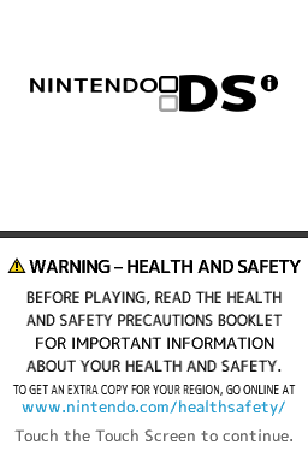
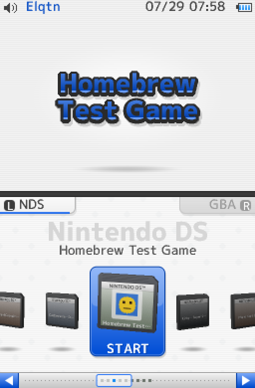
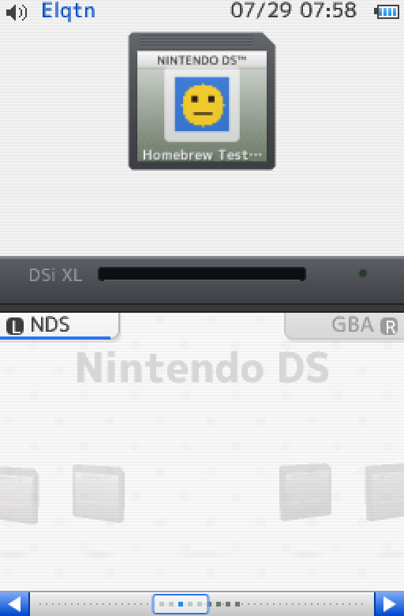
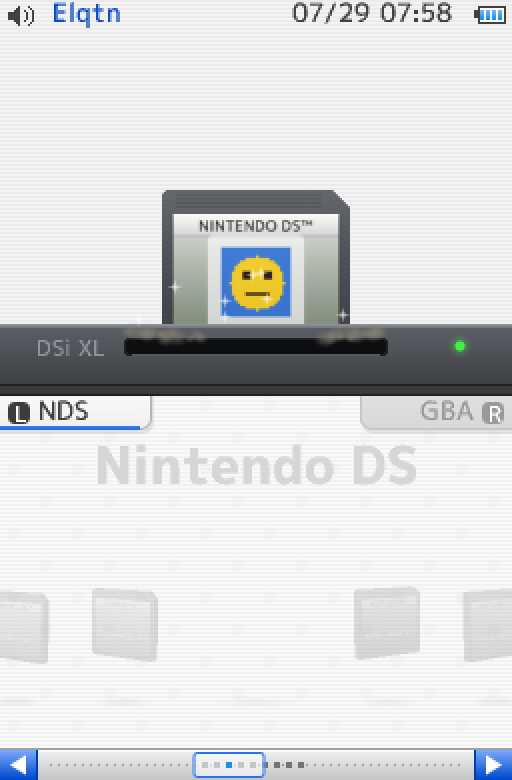

# DSi Menu for ROCKNIXDS (RG DS Plus)

A Nintendo DS and Game Boy Advance menu for the Anbernic RG DS Plus running ROCKNIX with ROCKNIXDS, made to look
and feel like the Nintendo DSi's own menu. Both screens are drawn at the DS's 256x192 and shown at exactly 4x on
the Plus's 1024x768 panels: no HD redraw, no filtering.

<p align="center">
  
  
  
  
</p>
<p align="center"><sub>Boot, the menu, and a game starting (games without art, as the menu draws them; with art the
cartridges carry their box art and the top screen the game's logo).</sub></p>

## What it does

- **Boot.** Black to white, the DS logo and its chime on the top screen, the health and safety screen on the
  bottom, "Touch the Touch Screen to continue." pulsing. A touch or any button, then the menu slides in from white.
- **Top screen.**
  - The DSi's status bar: the speaker, the date, the time with its blinking colon, the battery.
  - The DSi's grey stripes with a faint drifting diamond pattern.
  - The selected game's **title logo**, floating, with a soft glow, a shadow on the floor, a glint and sparkles.
    With no logo, its title set as one.
  - **X** switches to the **photo view**: the game in a white photo frame, a little crooked, as the DSi showed
    your photos. A game with a logo gets a screenshot with the logo floating over it; a game without one (most DS
    games) gets its title screen alone, which carries the logo. X again goes back. The menu remembers which.
- **Bottom screen.**
  - White with the DSi's stripes and a slow pattern.
  - **3D cartridges** in a row: a DS game card or a GBA Game Pak, carrying the game's art.
  - The selected cartridge pops out in full colour in the DSi's selection frame. The frame travels with the
    cartridges (it lunges for the next one and they settle together), and a light passes over it now and then. The
    others float, smaller and greyer.
  - **L NDS / GBA R** tabs. The system's name as a watermark ("Nintendo DS", like "Nintendo DSi Menu").
  - The DSi's scroll bar along the bottom.
- **Starting a game.** The cartridge squashes, jumps off the bottom screen and comes up into the top one with a
  full turn. It hangs, then **slams down into the card slot** that has risen at the bottom of the top screen:
  the cartridge goes into the slot's slit with a thud, shake, dust, the power lamp. Then white, as the DSi does, and the game.
- **Back from a game.** The cartridge pops out of the slot, drops through to the bottom screen and lands back in
  its place.
- **Tactile navigation.** A press lands in about a tenth of a second, and the selection locks into its frame like a
  detent: a click, a squeeze of the frame, a short buzz of the vibration motor. Holding left/right glides along
  the row, faster and faster, and settles on the next cartridge when you let go. A flick coasts on, ticking past
  each cartridge, and slows to a stop. The ends of the list stretch like rubber and snap back. Holding A sinks the
  cartridge in; letting go starts it. L and R push their tabs in.
- **Alive.** Cartridges wobble like jelly when tapped, tilt as the row moves, and lean toward the selected one.
  After 15 seconds untouched, the selected one turns all the way round or a
  wave runs along the row. Taps leave a burst of stars in your colour. The bottom screen and the selection frame
  take on the selected game's own colour (from its box art), and the pattern slides slower than the row
  (parallax). The cursor tick rises in pitch along the list. On your birthday (`birthday = MM-DD` in
  `config.ini`): a cake by your name and confetti. In December: snow on the top screen.
- **Tactile everywhere.** Springs with a little overshoot, eases, a bump at the ends of the list, sounds on every
  move. Touch works throughout: drag or flick the row, tap a cartridge, tap the selected one to start it, tap the
  tabs, the scroll bar and its arrows.

## Controls

| | |
|---|---|
| Left / Right | the previous / next game (hold: a glide that speeds up) |
| Up / Down | five games back / on |
| L / R | the tabs: NDS, ★ Favorites (the middle one, where the menu opens), GBA |
| SELECT (or the gear, bottom right) | the selected game's settings |
| A (or tap the selected cartridge) | start it (on release: the cartridge sinks in while held) |
| X | the top screen: the logo, or the photo view |
| Y | a favourite, or not (a gold star on the cartridge) |
| START | Options: colour, clock, sound effects, music, vibration, look for new games, exit to EmulationStation, power off |
| B | close the options |

**Favorites** are a tab of their own, the middle one, and the menu opens on it:
- Its own look in the same DSi style: warm cream paper with little stars, a white lacquered shelf with a gold edge
  that the cartridges stand on, a gold selection frame, "★ Favorites" pressed in.
- DS cards and Game Paks side by side, in the order you added them.
- First, on a little shelf of its own: **Continue**, the game you played last, with a "Continue" balloon over it,
  "Continue playing: ..." in the title line and CONTINUE in its frame. Coming back from a game lands it there.
- Y on a favourite there takes it off the shelf (its neighbours close up); in the NDS and GBA tabs Y puts the star
  on or off, and favourites stay in their alphabetical places, marked in gold on the scroll bar.
- Kept in `/storage/.config/dsixl/favorites.txt` (a line per game, `NDS<tab>file name`, in the order added).

**Game settings** (SELECT, or tap the gear): each game's emulator options, in a window on the bottom screen.
- Up/Down picks an option, Left/Right (or the arrows) changes it, the top screen says what the option does and
  what the choice does.
- The recommended choice of each option has a little gold star; **Recommended** puts them all back. **Play**
  starts the game with them; B keeps them and closes.
- DS (ROCKNIXDS's DraStic): Screen (Crisp pixels, Pixel grid, Crisp with DS colors, Smooth, Pixel-perfect),
  Performance (Battery saver, Balanced, Max performance), 3D quality (2x, 3x), 3D textures, 3D engine, Resume.
- GBA (RetroArch): Emulator (mGBA, gpSP), Screen size (Pixel-perfect, Fill screen), Screen (Sharp, Smooth), Resume,
  Rewind, Response (run-ahead).
- They're written to ROCKNIX's `system.cfg` as that game's own settings (`nds["<file>"].shader=ds-crisp`), the
  same keys EmulationStation uses: the game starts with them, and EmulationStation shows them too.

No emulator is bundled: the menu starts the ones on the handheld (ROCKNIXDS's DraStic for DS, ROCKNIX's RetroArch
for GBA).

## Install (on the handheld, over ssh)

```sh
# copy this repository (or its release) to the handheld, e.g. /storage/dsixl-src, then:
sh /storage/dsixl-src/device/install.sh            # installs; try it from EmulationStation: Ports > DSi Menu
sh /storage/dsixl-src/device/install.sh --enable   # ...and make it what the handheld boots into
sh /storage/dsixl-src/device/install.sh --disable  # EmulationStation at boot again
```

How it fits in:
- At boot, ROCKNIX starts sway and EmulationStation's service. With the menu enabled, that service runs this
  menu's launcher instead (`device/start_es.sh`, bind-mounted over `/usr/bin/start_es.sh` by
  `/storage/.config/autostart/zz-dsixl`).
- That launcher hands the panels to the menu's own systemd unit (`device/session.sh`). The menu then draws on both
  panels directly, as ROCKNIXDS's DraStic does.
- **Exit to EmulationStation** in the options brings back exactly what you had, until the next boot.
- If the menu fails to start twice in a row, the session falls back to EmulationStation and shows why.

Games:
- **NDS** runs ROCKNIXDS's DraStic with libdsflip, straight to both panels (`device/launch.sh`), with your
  EmulationStation DS settings: power profile, 3D renderer, 3D resolution and texture filter. Resume-on-quit
  works too: the exit hotkey saves, and the next start carries on.
- **GBA** runs RetroArch (mGBA; set `gba_core` in `config.ini` to change it) through ROCKNIX's `runemu.sh` on
  the top screen.
- The menu quits while a game runs, so the game gets all of the 1 GB.

ROMs: `/storage/roms/nds` and `/storage/roms/gba` (set in `/storage/.config/dsixl/config.ini`).

## Art

```sh
python3 /storage/.config/dsixl/dsixl-scrape.py      # on the handheld (Wi-Fi), or on a computer with --nds/--gba/--media
```

No account and no key needed. The **LaunchBox Games Database** comes first, for everything it has: its public
database (`Metadata.zip`, downloaded once a month into `media/.launchbox/` and read as a stream, so it fits in the
handheld's memory) lists each game's images, matched to your ROMs by name (alternate names too), your ROM's region
first:

| LaunchBox image | Used as |
|---|---|
| Cart - Front | the cartridge's whole face (a real scan) |
| Box - Front | the box (cropped to a label when there's no cartridge scan) |
| Clear Logo | the top screen's logo |
| Screenshot - Gameplay | the photo view, with the logo under it |
| Screenshot - Game Title | the photo view, for games without a logo |

What LaunchBox doesn't have comes from GameTDB (DS covers and cartridge scans, by the game code in the ROM) and
libretro-thumbnails (box art, title screens, screenshots, GBA logos). `--no-launchbox` skips LaunchBox;
`--refresh-launchbox` downloads its database again now.

Your own art always wins. Drop files in `/storage/roms/dsixl/media/<nds|gba>/<box|cart|label|logo|title|snap>/<ROM name
without extension>.png` (or `.jpg`): a `cart` is a scan of the real cartridge (used as its whole face), a `label`
fills the label area, a `box` is cropped to the label (its spine strip, rating and publisher strip cut off), a
`logo` should be a transparent PNG.
The menu also reads EmulationStation's scraped media beside the ROMs (`images/<name>-marquee.png` as the logo,
`-thumb`/`-image` as the box), so ScreenScraper art you already have shows up too.

## Sounds

Put the DSi's sounds (your own copies) in `/storage/roms/dsixl/sounds`: `boot.wav`, `cursor.wav`, `select.wav`,
`launch.wav`, `slam.wav`, ..., `music.mp3`. Every slot and the DSi sound that belongs in it:
[docs/sounds.md](docs/sounds.md). Until then, synthesized stand-ins play.

## Customising

- `config.ini`: your colour (`color`, the DS's 16 favourite colours: the selection frame, the
  tabs, the scroll bar, the title logos follow it), 12/24-hour clock, the boot screen (`boot_splash`, and
  `boot_wait = n` to continue by itself after n seconds), the ROM, art and sound folders.
- `assets/boot_logo.png`: the boot logo is an approximation drawn by `tools/gen_assets.py`. Replace it with your
  own transparent PNG (about 216x32) to have the real one.
- The look lives in `src/widgets.c` (the DSi furniture, colours sampled from the DSi), `src/ui.c` (layout,
  animations, timings: the launch is the `L_*` timeline) and `src/cart.c` (the cartridges' shapes and faces).

## Building

```sh
sh build.sh            # this computer: build/dsixl (try it: ./build/dsixl --backend sdl, arrows/Z/X/Q/E/Enter, mouse = touch)
sh build.sh aarch64    # the handheld: build/dsixl-aarch64 (apt install gcc-aarch64-linux-gnu libdrm-dev libsdl2-dev)
```

C, no dependencies to link: libdrm, ALSA and SDL2 are opened at run time. `bin/dsixl-aarch64` is a prebuilt copy;
the installer uses `build/` first. Pictures without a display:
`./build/dsixl --backend headless --record out/ --seconds 8 --script "2:A,4:RIGHT"` writes every frame as PNG.

Hardware notes and how the menu fits in 1 GB: [docs/hardware.md](docs/hardware.md).
Third-party code and fonts: [THIRD_PARTY.md](THIRD_PARTY.md).
