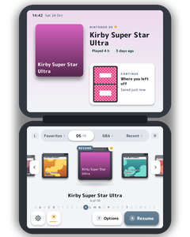

# DSi Menu 2 for the RG DS Plus (BananaOS)

A home menu for Nintendo DS and Game Boy Advance games on the Anbernic RG DS Plus, made as if Nintendo had made a
successor to the DSi's menu for this handheld: both 1024x768 screens at their own resolution, the top one a stage for
the game you're on, the bottom one the deck you touch. It runs on [BananaOS](https://github.com/JorreFog/BananaLinux),
from its shelf, and starts your games with BananaOS's own launchers and settings.



## What it does

- **The stage (top screen).** The selected game big: its box art, its name, how long you've played it and when.
  **Where you left off**: both of the DS's screens exactly as they were when you last quit, read from DraStic's
  resume state.
- **The deck (bottom screen).** Shelves for Favorites, DS, GBA and Recent (L / R, or tap). Real DS and GBA
  cartridges with your games' art on their labels. Move with the d-pad, or drag and flick them with a finger. Tap
  the middle one, or flick it up, to play. A–Z along the bottom: slide a finger along it to jump.
- **A game's page** (Y, or hold a finger on its cartridge):
  - **Resume**, or **From the start**: the title screen, with your save kept and your resume point put back after.
  - **Four save-state slots**, each with its two screens.
  - **This game's own screen look**, previewed live on the top screen on the game's own pixels.
- **The big moments.**
  - **Start-up.**
  - **A game going in**: the cartridge leaps off the deck, rises onto the stage and opens into its art.
  - **Coming back out**: the art folds into its cartridge, which drops through the hinge onto the deck.
  - **Sleep**: a moon over "Good night", from the START menu.
  - **Waking**: light from the hinge, after the lid, the power button or the menu's own Sleep.
- **Feel.**
  - **Every press:** buttons sink under your finger and spring back, the cartridges bounce into place, and a
    single focus ring glides between things.
  - **Sound:** a sound for each action, and the menu's own soft tune.
  - **Vibration:** the motor buzzes when a game goes in or lands back, at the end of a shelf, and on a long press.
- **Light or night by the clock**, in your DS favorite color.
- **Small things:**
  - a RESUME badge on games with a resume point, and NEW on games you haven't played yet;
  - a low-battery warning, and a chime when the charger goes in;
  - BananaOS's volume and brightness levels shown as they change;
  - shelves sorted A to Z, by recently played or by most played;
  - Get box art in Settings.

## Controls

| | Home | A game's page | Settings |
|---|---|---|---|
| D-pad | Left / right: games. Up / down: a letter at a time | Move | Up / down: settings. Left / right: change |
| A | Play (or resume) | Choose | Change |
| B | | Back | Back |
| X | Favorite | Favorite | |
| Y | The game's page | | |
| L / R | Shelves | Screen look | Sections |
| SELECT | Settings | | Back |
| START | The menu: Sleep, Settings, Exit to BananaOS, Power off | | Back |

Touch does everything too: drag or flick the cartridges, tap one to bring it to the middle, hold one for its page,
swipe a game's page down to close it.

## Install

1. Download `dsixl-1.0.0.zip` and unzip it onto the root of the BananaOS card. It puts `Install DSi Menu`,
   `Uninstall DSi Menu` and the folder `dsixl-files` in `roms/ports` (all three are needed).
2. On the handheld: BananaOS's **Ports** shelf, **Install DSi Menu**. The menu opens; from then on it's **DSi Menu**,
   first on BananaOS's shelf. If nothing happens, `dsixl-install.log` on the card says why.
3. Open it. **START > Exit to BananaOS** goes back.

Everything goes on the card: the menu in `/data/dsixl`, its two screen looks in `/data/banana/shaders`, and its entry
in `/data/banana/systems.conf`. **Uninstall DSi Menu** takes it all away again (your art stays).

## Screen looks

Two shaders for DraStic and BananaDS, also listed in BananaOS's own Settings:

- **DSi LCD**: the DSi screen's colour stripes and the fine gaps between its pixels.
- **DSi LCD + DS colors**: the same, in the DS screen's softer, warmer colours.

Settings > DS screen look sets them for every game; a game's page sets one for that game alone (BananaOS's
`nds-per-game-shader.conf`).

## Art

**Settings > Get box art** fetches covers for every game without one, over Wi-Fi, in the background, from sources
that need no account: the LaunchBox Games Database, GameTDB and libretro-thumbnails. The covers appear as they
arrive. It needs Python 3.

Your own art wins. The menu looks in:

- `/data/dsixl/media/<nds|gba>/box/<ROM name without extension>.png` (or `.jpg`);
- BananaOS's own `roms/<nds|gba>/media/box/`.

A game without art gets a cover made from its DS icon, its name and its own colours.

## Sounds

Synthesized sounds play unless you add your own. Put sound files (your own copies of the DSi's) in
`/data/dsixl/sounds`; [docs/sounds.md](docs/sounds.md) lists every slot.

## Performance

Made for the RG DS Plus's CPU: everything is drawn in software at the panels' own resolution, and only what changed
is drawn.

- **Idle:** a still menu costs nothing; no frame is drawn or sent.
- **Shadows and pages:** soft shadows come from cached tiles, and the pages under a transition or an animation
  are drawn once and reused.
- **Prepared in idle frames:** cartridges next to the selection, and the selected game's page.

`DSIXL_PROFILE=1` logs every frame's cost to `/data/dsixl/data/dsixl.log`.

## Building

```sh
sh build.sh            # this computer: build/dsixl (./build/dsixl --backend sdl, or --backend headless)
sh build.sh aarch64    # the handheld: build/dsixl-aarch64 (apt install gcc-aarch64-linux-gnu libdrm-dev libsdl2-dev)
sh tools/package.sh    # dist/dsixl-<version>.zip
```

C with nothing to link but glibc: libdrm, ALSA, SDL2 and zlib are opened at run time. Pictures without a display:
`./build/dsixl --backend headless --record out/ --seconds 4 --script "1:RIGHT,2:Y"` writes the frames as PNGs
(`DSIXL_SNAP="1.5,3"`: only those moments). The fonts are M PLUS Rounded 1c, baked by `tools/gen_hdfont.py`.

Third-party code and fonts: [THIRD_PARTY.md](THIRD_PARTY.md).
